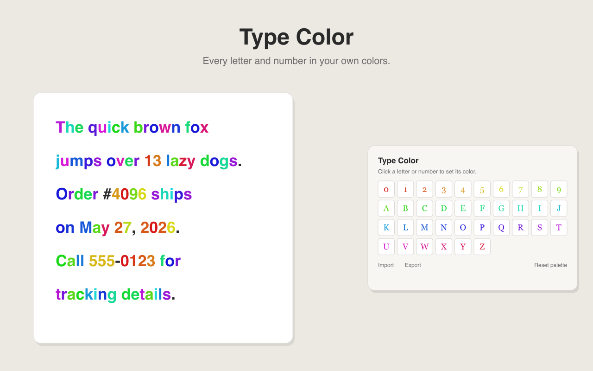

# Type Color

A Chrome extension that recolors letters and digits on web pages using a
palette you choose. Each glyph — 0–9 and A–Z — gets its own color.

Built primarily for grapheme-color synesthetes, but useful to anyone who
wants per-character color on the web.



## Features

- 36 editable color slots, one per glyph (case-insensitive)
- Changes apply to open tabs immediately — no reload
- Per-site toggle to disable recoloring on any domain
- Export and import your palette as JSON
- No servers, no analytics, no tracking. Everything runs locally.

## Install

Chrome Web Store listing: pending review.

To install from source:

```
npm install
npm run build
```

Then open `chrome://extensions`, enable Developer mode, click
**Load unpacked**, and select the `dist/` folder.

## Development

```
npm run build        # typecheck + production build into dist/
npm run build:icons  # regenerate icon PNGs from assets/icon.svg
npm run package      # build and zip dist/ for the Web Store
```

Stack: Vite, TypeScript, [crxjs](https://crxjs.dev/vite-plugin), Manifest V3.

## Palette JSON format

Export produces:

```json
{
  "format": "type-color-palette",
  "version": 1,
  "palette": { "0": "#d81818", "A": "#c8d818", "...": "..." }
}
```

Colors are six-digit hex. Unknown keys are ignored on import; missing
glyphs fall back to the default palette.

## Privacy

Type Color reads page text locally to recolor it and stores your palette
in Chrome's sync storage. Nothing leaves your browser. Full policy:
[PRIVACY.md](PRIVACY.md) or the
[hosted version](https://fatpash9.github.io/type-color/).

## License

[GPL-3.0](LICENSE)
